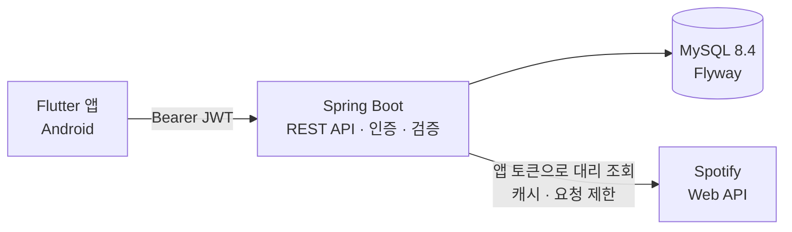
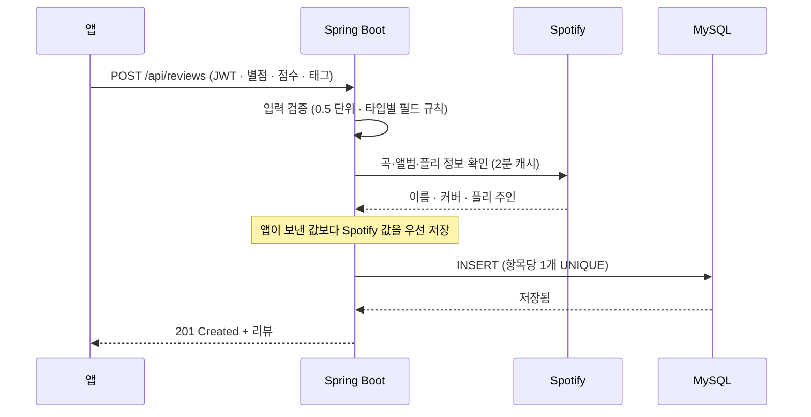
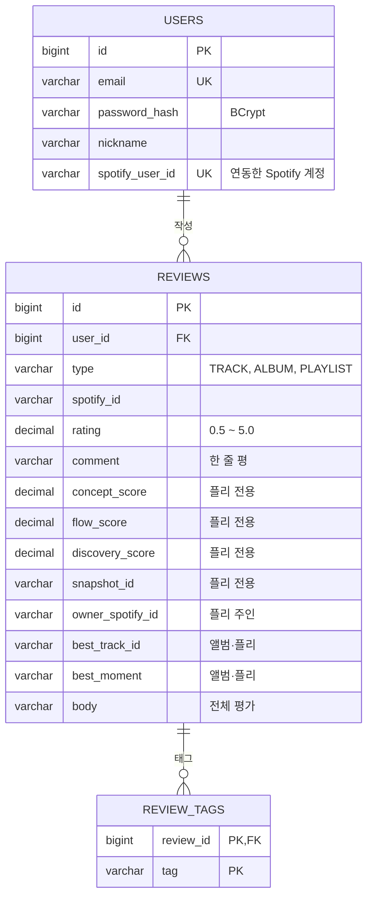

<div align="center">

# 🎧 PLIVIEW

**듣고, 점수 주고, 같이 고르는 플리**

Spotify의 곡 · 앨범 · 플레이리스트에 별점과 리뷰를 남기는 앱 **PLIVIEW**의 백엔드 서버


[📱 Flutter 앱 저장소](https://github.com/minwoo0708/PLIVIEW_app) · [📘 API 명세서](docs/API.md) · [🗄 DB 스키마](docs/schema.sql)

</div>

<br>


<p align="center"><sub>앱 화면 디자인 · 시작, 홈, 탐색, 재생 기록, 프로필, 앨범·플리 상세, 평가하기, 큐레이터 랭킹, 로그인·가입, 설정</sub></p>

> 곡도 앨범도 플레이리스트도 **내 기준으로 기록**해요. 음악 정보는 Spotify에서 가져오고,
> 회원·리뷰·통계는 이 서버가 맡습니다. 클라이언트는 **Flutter로 만든 안드로이드 앱**이에요(웹은 디자인이 없어 보류 중).


## ✨ 주요 기능

| | 기능 | 설명 |
|---|---|---|
| 🔐 | **계정** | 이메일 회원가입·로그인(JWT), 닉네임·프로필 사진 수정, 비밀번호 변경, 회원 탈퇴 |
| ⭐ | **리뷰** | 곡·앨범·플리에 **별점(0.5 단위)** · 한 줄 평 · 태그. 항목당 1인 1리뷰, 본인 리뷰만 수정·삭제 |
| 💿 | **앨범·플리 평가** | 최고의 곡 · 워스트 곡 · 과소평가된 곡(앨범만) · 최고의 순간 · 전체 평가(여러 줄) |
| 🎚 | **플리 전용 점수** | 컨셉 일치도 · 곡 흐름 · 발견성 + 총점. 리뷰 뒤 플리가 바뀌었는지 알 수 있게 `snapshot_id`를 함께 저장 |
| 📊 | **통계** | 항목별 평균과 별점 분포(10칸), 유저 프로필 통계, 곡별 평점 일괄 조회 |
| 🏠 | **홈** | 최신 리뷰 피드, 요즘 리뷰 많은 항목, 이번 주의 플리 |
| 🏆 | **베스트 큐레이터** | Spotify를 연동한 사용자가 만든 플리의 평균 점수 순위(동점은 같은 순위), 큐레이터 프로필, 인기순 플리 |
| 🎧 | **Spotify 대리 조회** | 검색 · 곡 · 앨범 · 아티스트 앨범 · 플리 정보를 서버가 대신 조회. 앱은 Spotify 로그인 없이도 음악 정보를 봅니다 |
| 🔗 | **Spotify 계정 연동** | 앱이 PKCE로 받은 토큰을 서버가 확인만 하고 **저장하지 않습니다** |

## 🏗 아키텍처



음악 정보는 서버가 **자기 Spotify 앱 자격 증명(Client Credentials)** 으로 대신 가져와서, 앱에 Client Secret을 둘 필요가 없어요.
사용자 본인의 Spotify 권한이 필요한 기능(최근 재생)만 앱이 **PKCE**로 Spotify에 직접 요청합니다.

### 리뷰를 쓰면 일어나는 일




## 🗄 데이터 모델



- `reviews`는 `(user_id, type, spotify_id)`가 **UNIQUE**라서 한 항목에 한 사람이 리뷰를 하나만 쓸 수 있어요.
- 평균·별점 분포·랭킹은 별도 통계 테이블 없이 **SQL 집계**(`AVG`, `GROUP BY`)로 계산합니다.
- 피드와 이름·이미지 표시용으로 리뷰에 항목 정보(`item_name`, `item_subtitle`, `item_image_url`)를 함께 저장해, 목록마다 Spotify를 다시 부르지 않아요.

## 🧰 기술 스택

| 영역 | 사용 기술 | 이유 |
|---|---|---|
| 언어 · 런타임 | **Java 21** (Temurin) | LTS, record로 DTO를 간결하게 |
| 프레임워크 | **Spring Boot 4.1** (Web MVC, Data JPA, Validation) | REST API와 영속성 |
| 인증 · 보안 | **Spring Security 7** · OAuth2 Resource Server(JWT, HS256) · BCrypt | 세션 없는 stateless 인증 |
| DB | **MySQL 8.4** (개발·테스트는 H2) | 실제 DB로 확인, 테스트는 빠르게 |
| 마이그레이션 | **Flyway** | 스키마 변경 이력을 파일로 관리 |
| 캐시 | **Caffeine** | Spotify 응답 · 요청 제한 카운터 |
| 외부 연동 | **Spotify Web API** (`RestClient`) | 검색 · 곡 · 앨범 · 플리 정보 |
| 빌드 · 테스트 | **Gradle** · JUnit 5 · MockMvc | 통합 테스트 68개 |
| 협업 도구 | Postman · IntelliJ HTTP Client | 요청 모음 포함 |


## 🔌 API 한눈에 보기

모든 에러는 같은 JSON 형식(`status`, `code`, `message`, `errors`, `timestamp`)으로 응답하고, 목록은 같은 페이지 형식을 씁니다.
요청·응답 예시와 에러 코드는 **[docs/API.md](docs/API.md)**에 있어요.

<details>
<summary><b>API 29개 전체 보기</b></summary>

<br>

| 영역 | 메서드 · 경로 | 설명 |
|---|---|---|
| 확인 | `GET /api/hello` | 서버 동작 확인 |
| 계정 | `POST /api/auth/signup` | 회원가입 (가입 즉시 로그인) |
| | `POST /api/auth/login` | 로그인 |
| | `GET` `PATCH /api/users/me` | 내 정보 · 닉네임·프로필 사진 수정 |
| | `PATCH /api/users/me/password` | 비밀번호 변경 |
| | `DELETE /api/users/me` | 회원 탈퇴 (리뷰도 삭제) |
| | `PUT` `DELETE /api/users/me/spotify` | Spotify 계정 연동 · 해제 |
| Spotify | `GET /api/spotify/search` | 곡·앨범·아티스트·플리 검색 |
| | `GET /api/spotify/tracks/{id}` | 곡 정보 |
| | `GET /api/spotify/albums/{id}` | 앨범 정보 + 수록곡 |
| | `GET /api/spotify/artists/{id}/albums` | 아티스트의 앨범 |
| | `GET /api/spotify/playlists/{id}` | 플리 정보 |
| 리뷰 | `POST /api/reviews` | 리뷰 작성 |
| | `GET` `PATCH` `DELETE /api/reviews/{id}` | 조회 · 수정 · 삭제 |
| | `GET /api/reviews/mine` | 여러 항목에 대한 내 리뷰 일괄 조회 |
| 항목 | `GET /api/items/{type}/{id}/reviews` | 항목의 리뷰 목록 (정렬·페이지) |
| | `GET /api/items/{type}/{id}/summary` | 평균 · 별점 분포 · 내 리뷰 |
| | `GET /api/items/tracks/ratings` | 곡별 평점 일괄 조회 |
| 홈 · 프로필 | `GET /api/feed` | 최신 리뷰 피드 |
| | `GET /api/feed/popular` | 리뷰 많은 항목 |
| | `GET /api/feed/weekly-playlists` | 이번 주의 플리 |
| | `GET /api/users/{id}/reviews` | 유저의 리뷰 + 통계 |
| 큐레이터 | `GET /api/curators/ranking` | 베스트 큐레이터 순위 |
| | `GET /api/curators/{id}` | 큐레이터 프로필 |
| | `GET /api/curators/{id}/playlists` | 큐레이터의 플리 (인기순) |

</details>

## 🧠 설계에서 신경 쓴 점

**🔐 인증 · 보안**
- 세션 없이 **JWT(HS256, 7일)** 로 인증하고 비밀번호는 **BCrypt**로만 저장합니다. 응답에 비밀번호가 나오지 않아요.
- 필터 단계의 401·403도 서버 공통 에러 형식으로 응답해, 앱이 에러를 한 가지 방식으로 처리할 수 있어요.
- 로그인 실패는 "이메일이 없는지 / 비밀번호가 틀렸는지"를 알려 주지 않습니다.
- 웹 클라이언트가 다른 포트에서 부를 수 있게 CORS를 설정해 두었고(웹 앱은 보류 중), 배포 주소는 환경변수로 추가합니다.

**✅ 입력 검증 · 정합성**
- 별점·닉네임·비밀번호·Spotify id는 **커스텀 검증 어노테이션**(`@Score`, `@Nickname`, `@Password`, `@SpotifyId`)으로 한 곳에서 관리합니다.
- 곡에 플리 전용 항목을 보내거나, 플리에서 필수 항목이 빠지면 거절합니다.
- "항목당 1인 1리뷰"는 UNIQUE 제약으로 보장하고, 동시에 두 번 요청해도 한 번만 저장됩니다.
- 수정 요청의 `clear`로 선택 항목을 명시적으로 지울 수 있어서, "보내지 않음"과 "지움"이 헷갈리지 않아요.

**🎧 Spotify 연동**
- 앱 토큰은 만료 직전까지 재사용하고, 유효한 토큰이 있으면 **잠금 없이** 바로 돌려줍니다.
- 같은 요청은 **2분 캐시**, 사용자당 **1분 60회 제한**으로, 모든 사용자가 토큰 하나를 같이 써도 한 명의 연타가 전체에 번지지 않게 했어요.
- 쿼리를 엄격하게 인코딩해서 `C++` 같은 검색어도 정확히 전달하고, Spotify의 오류를 우리 에러 코드로 구분해 돌려줍니다.
- **신뢰할 수 없는 입력 방어**: 리뷰를 저장할 때 서버가 Spotify에서 이름·커버·플리 주인을 다시 확인해, 앱이 보낸 값으로 큐레이터 랭킹을 조작하지 못하게 합니다.

**⚡ 성능 · 운영**
- 인기 항목과 큐레이터 목록의 표시 정보를 항목마다 조회하지 않고 **타입별로 묶어서** 한 번에 가져옵니다(N+1 제거).
- 타입별 피드는 쿼리를 나누고 인덱스를 추가했어요.
- 스키마는 **Flyway**로만 바꾸고, mysql 프로필의 Hibernate는 엔티티와 테이블이 맞는지 **검사만**(`validate`) 합니다.

**🧪 테스트**
- 실제 HTTP 요청처럼 호출하는 **MockMvc 통합 테스트 68개**. 인증, 검증, 권한, 집계, 페이지, 에러 형식을 확인합니다.
- Spotify는 테스트 안에서 띄운 **가짜 HTTP 서버**로 대신해서, 토큰 캐시 · 응답 캐시 · 쿼리 인코딩 · 오류 변환을 외부 의존 없이 검증합니다.


## 🚀 실행 방법

### 1분 만에 실행 (H2 메모리 DB)

설치할 것 없이 JDK 21만 있으면 됩니다. 서버를 끄면 데이터는 사라져요.

```bash
git clone https://github.com/minwoo0708/PLIVIEW_server.git
cd PLIVIEW_server
./gradlew bootRun
```

- 서버: http://localhost:8080 · 확인: http://localhost:8080/api/hello
- H2 콘솔: http://localhost:8080/h2-console (JDBC URL `jdbc:h2:mem:music_review`, 사용자 `sa`)

### MySQL로 실행

**테이블은 서버가 만듭니다.** mysql 프로필로 켜면 [Flyway](https://flywaydb.org)가 `src/main/resources/db/migration`의 `V1`, `V2`, `V3` ...을 순서대로 적용하니, 빈 DB만 한 번 만들면 돼요.

```bash
mysql -u root -p -e "CREATE DATABASE IF NOT EXISTS music_review DEFAULT CHARACTER SET utf8mb4 DEFAULT COLLATE utf8mb4_unicode_ci"
```

```powershell
# PowerShell
$env:SPRING_PROFILES_ACTIVE="mysql"
$env:DB_PASSWORD="MySQL root 비밀번호"
$env:JWT_SECRET="32자 이상 임의 문자열"
./gradlew bootRun
```

IntelliJ에서는 **Run → Edit Configurations → Environment variables**에 같은 값을 넣으면 됩니다.
Spotify 검색·정보 조회를 쓰려면 `SPOTIFY_CLIENT_ID`, `SPOTIFY_CLIENT_SECRET`도 필요하고, 없으면 `/api/spotify/**`만 503을 돌려줍니다(나머지는 정상).

<details>
<summary><b>환경변수 · Flyway 안내 전체 보기</b></summary>

<br>

| 환경변수 | 기본값 | 설명 |
|---|---|---|
| `SPRING_PROFILES_ACTIVE` | `local` | `local`(H2) 또는 `mysql` |
| `DB_HOST` / `DB_PORT` / `DB_NAME` | `localhost` / `3306` / `music_review` | mysql 프로필 |
| `DB_USERNAME` | `root` | mysql 프로필 |
| `DB_PASSWORD` | (없음) | mysql 프로필, **필수** |
| `JWT_SECRET` | local만 개발용 기본값 | 32바이트 이상, mysql 프로필에서는 **필수** |
| `SPOTIFY_CLIENT_ID` / `SPOTIFY_CLIENT_SECRET` | (없음) | [Spotify Dashboard](https://developer.spotify.com/dashboard)에서 발급 |
| `SPOTIFY_RATE_LIMIT_PER_MINUTE` | `60` | 사용자 한 명이 1분에 보낼 수 있는 `/api/spotify/**` 요청 수 |
| `CORS_ALLOWED_ORIGINS` | `http://localhost:*,http://127.0.0.1:*` | 웹 클라이언트 배포 주소를 쉼표로 추가 |
| `FLYWAY_BASELINE_VERSION` | `2` | Flyway 도입 전에 만든 DB를 몇 번 마이그레이션까지 적용된 것으로 볼지 (빈 DB는 영향 없음) |

- **스키마를 바꿀 때**는 엔티티를 고치고 새 마이그레이션(`V4__설명.sql`)을 추가합니다. 이미 적용된 `V1~V3`은 **수정하지 마세요**(체크섬 불일치로 서버 시작이 막혀요).
- Flyway 도입 전에 만든 DB는 처음 켤 때 "V2까지 적용"으로 보고 V3만 적용합니다. 더 오래된 DB는 `FLYWAY_BASELINE_VERSION=1`.
- `docs/schema.sql`은 최종 스키마를 보여 주는 **참고용**이라 직접 실행하지 않아도 됩니다.
- 비밀번호나 키는 절대 커밋하지 마세요. `.env`, `http/http-client.private.env.json`, Postman 로컬 워크스페이스 파일은 `.gitignore`에 등록돼 있습니다.

</details>

### Flutter에서 접속

| 실행 환경 | Base URL |
|---|---|
| Flutter 웹 (Chrome, 현재는 보류) | `http://localhost:8080` (CORS 허용) |
| 안드로이드 에뮬레이터 | `http://10.0.2.2:8080` |
| 실제 폰 (같은 Wi-Fi) | `http://<PC의 IP>:8080` |

## 🧪 테스트

```bash
./gradlew test
```

**Postman으로 직접 호출해 보기**
1. Postman → **Import** → [`postman/`](postman/) 폴더의 두 파일(컬렉션 + `PLIVIEW local` 환경)
2. 서버를 켜고 **회원가입**(처음) 또는 **로그인**을 실행하면 `jwt`가 자동 저장돼 나머지 요청에 붙어요.
3. `[실패]`로 시작하는 요청은 에러 응답(400·401·409)이 명세대로 나오는지 확인하는 용도입니다. (`9. 탈퇴` 폴더는 계정이 지워지니 Run collection에서 빼세요.)

IntelliJ를 쓴다면 [`http/api.http`](http/api.http)로도 같은 요청을 보낼 수 있습니다.

## 🗂 프로젝트 구조

```
src/main
├─ java/com/musicreview/server
│  ├─ global        공통: 보안(JWT, CORS), 에러 응답, 검증 어노테이션, 페이지 응답, 시간 기록
│  ├─ auth          회원가입 · 로그인
│  ├─ user          내 정보 · 비밀번호 · 탈퇴 · Spotify 연동 · 유저 프로필(리뷰·통계)
│  ├─ review        리뷰 CRUD · 태그 · 하이라이트 · 집계 쿼리
│  ├─ item          항목별 리뷰 목록 · 요약(평균·분포) · 곡별 평점
│  ├─ feed          최신 피드 · 인기 항목 · 이번 주의 플리
│  ├─ curator       베스트 큐레이터 랭킹 · 프로필
│  └─ spotify       Spotify 대리 조회 · 토큰 · 응답 캐시 · 요청 제한 · 항목 확인
└─ resources
   ├─ application*.yml    공통 / local(H2) / mysql 설정
   └─ db/migration        Flyway 마이그레이션 (V1 ~ V3)
docs/        API 명세 · 스키마 · Flutter 인수인계서 · 디자인 미리보기
postman/     Postman 컬렉션과 환경
http/        IntelliJ HTTP Client 요청 모음
```


## ⚠️ 알려진 제약

Spotify가 2026년 2월부터 **개발 모드 앱**에 제한을 걸어서, 아래 두 가지는 이 프로젝트에서 구조적으로 풀 수 없습니다.

| 제약 | 영향 | 대응 |
|---|---|---|
| 개발 모드 앱은 연동 가능한 사용자가 **최대 5명** | Spotify 연동과 베스트 큐레이터는 최대 5명까지 | 검색·곡/앨범 정보·리뷰는 연동 없이 누구나 사용 |
| 플리 **수록곡은 본인이 만들었거나 함께 편집하는 플리만** API로 제공 | 서버(앱 토큰)로는 플리 곡 목록을 받을 수 없음 | 앱은 플리 상세에서 **"Spotify에서 열기"** 버튼으로 연결 |

그 밖에 요청 제한은 **서버 한 대 기준**(메모리)이라, 서버를 여러 대로 늘리면 Redis 같은 공유 저장소로 바꿔야 해요.
Spotify 콘텐츠를 보여 줄 때는 Spotify 로고와 원본 링크를 표시합니다(브랜딩 가이드라인).

## 🗺 개발 현황

| 단계 | 내용 | 상태 |
|---|---|---|
| 1 | 프로젝트 생성 · API 명세 · DB 스키마 | ✅ |
| 2 | 공통 기반: 에러 응답 · 검증 · 시간 기록 · 페이지 응답 | ✅ |
| 3 | 인증: 회원가입 · 로그인 · JWT · CORS | ✅ |
| 4 | 회원: 내 정보 · 비밀번호 변경 · 탈퇴 | ✅ |
| 5 | 리뷰 CRUD · 항목 요약(평균·분포) | ✅ |
| 6 | Spotify 대리 조회 · 계정 연동 | ✅ |
| 7 | 피드 · 인기 항목 · 이번 주의 플리 · 유저 통계 · 큐레이터 랭킹 | ✅ |
| 8 | 앨범·플리 하이라이트 · 곡별 평점 | ✅ |
| 9 | 안정화: Spotify 응답 캐시·요청 제한 · Flyway · N+1 제거 | ✅ |
| 10 | CI(GitHub Actions) · 컨테이너화 · 클라우드 배포 | ⬜ 예정 |

## 📚 문서

| 문서 | 내용 |
|---|---|
| [docs/API.md](docs/API.md) | REST API 명세 (요청·응답 예시, 에러 코드, 설계 결정) |
| [docs/schema.sql](docs/schema.sql) | 최종 DB 스키마 (참고용) |
| [src/main/resources/db/migration](src/main/resources/db/migration) | Flyway 마이그레이션 |
| [docs/FLUTTER_HANDOFF.md](docs/FLUTTER_HANDOFF.md) | Flutter 앱 개발용 인수인계서 (서버 연동, 디자인 토큰, 화면별 API) |
| [postman/](postman/) · [http/api.http](http/api.http) | 요청 모음 |

<div align="center">

**PLIVIEW** · 개인 프로젝트 / 포트폴리오

[📱 Flutter 앱](https://github.com/minwoo0708/PLIVIEW_app) · [🍃 서버](https://github.com/minwoo0708/PLIVIEW_server)

</div>
